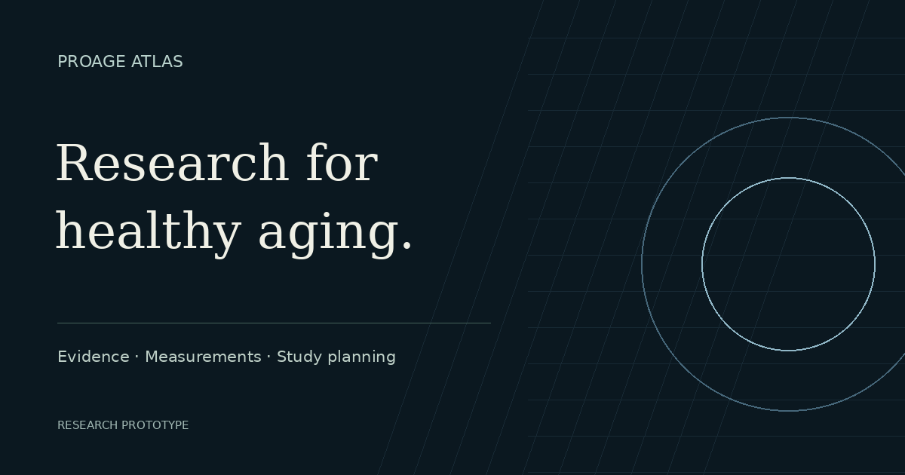
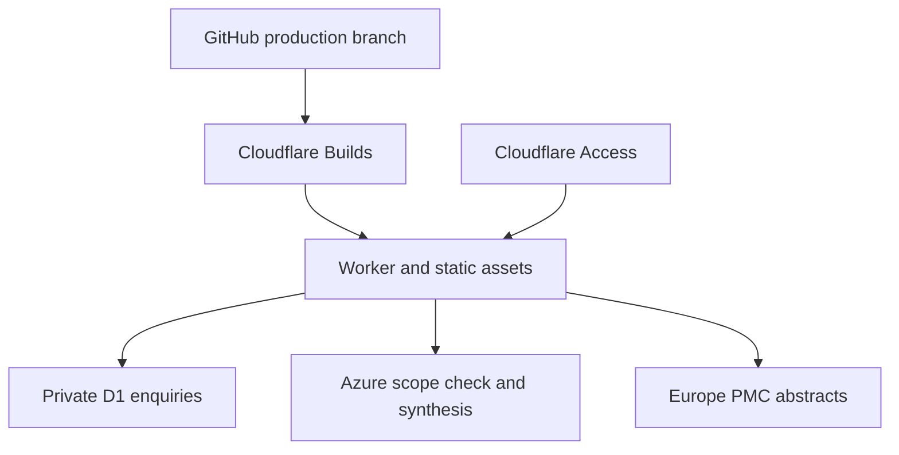

# ProAge Atlas

**An AI evidence workspace for geroscience teams — from a scientific question to a source-linked research brief.**

ProAge Atlas is an independent research software initiative for small geroscience and longevity research teams. This repository contains the public website and working prototype: a curated reference library, measurement-method context, two reproducible calculators and a scoped AI assistant with biomedical abstract retrieval, curated notes, follow-up conversations and exportable research briefs.

[Explore the platform](https://gerontology.app) · [Product direction](https://gerontology.app/about) · [Investors](https://gerontology.app/investors) · [Roadmap](https://gerontology.app/roadmap)

## What works today

| Instrument | Purpose | Boundaries |
| --- | --- | --- |
| Evidence library | Search selected references; filter by field, date and document type | A bounded curated collection, not a live literature search |
| PhenoAge Explorer | Calculate the published clinical biomarker model; inspect terms and export units/version | Clinical PhenoAge, not a DNA-methylation assay or a pace-of-aging estimate |
| Study Planner | Explore two-group sample size, noncentral-t power, allocation and dropout | Independent observations, normally distributed outcomes and pooled variance |
| Evidence Copilot | Search PubMed-indexed abstracts via Europe PMC or selected Atlas notes; ask follow-ups and export a cited brief | Abstracts/notes only; not a systematic review. Email verification, topic checks and durable request limits |
| Enquiries | Submit research, pilot and investment enquiries | Stored in a private D1 inbox; owner notifications through Cloudflare Email Service |

The site clearly separates ProAge Atlas product development from the Open Institute of Age and Aging's scientific and educational context. It does not claim clinical validation, customers, funding or completed commercial pilots. Saved research packages and team collaboration are on the roadmap.

## Production source

**Active production branch: `cloudflare/production`.** Cloudflare Workers Builds checks, builds and deploys this branch automatically. `main` retains the earlier Vercel implementation so its existing integration is not accidentally republished with an incompatible server build. All new product work starts from `cloudflare/production`.

```sh
git clone --branch cloudflare/production https://github.com/offflinerpsy/geromtology-ai-lab.git
cd geromtology-ai-lab
corepack enable
pnpm install --frozen-lockfile
pnpm dev
```

Use Node.js **22.19 or later** and the pinned pnpm version in `package.json`. No ChatGPT runtime or Sites helper is required to develop, build or deploy this application.

## Architecture

The application uses React 19, the Next.js App Router API and vinext/Vite, deployed as a Cloudflare Worker with static assets. Cloudflare D1 persists enquiries; Cloudflare Access verifies AI users and protects the owner's inbox. The Azure Responses API runs only on the server. Calculator inputs remain in the browser.



The approved visual system uses a light mineral background, deep green-black ink, a botanical accent and editorial typography. Preserve the original green WebGL home hero. Transparent Canvas scenes loop calmly and respect reduced motion and offscreen pause; do not add visible motion controls.

## Development and validation

```sh
pnpm typecheck
pnpm test
pnpm build
```

The tests cover independent PhenoAge and SciPy power fixtures, unit conversion, source classification, citation validation, retrieval normalization, scope/failure boundaries, bounded input and signed Access-token checks. A passing build does not establish browser accessibility, visual quality, animation frame rate or clinical validity. Inspect desktop/mobile layouts and real interactions before accepting UI changes.

The AI product decision and current limitations are recorded in [AI product direction](docs/product/ai-product-decision-20261025.md).

Runtime configuration is documented in [Deployment](docs/DEPLOYMENT.md). Product contribution rules are in [AGENTS.md](AGENTS.md); development guidance is in [CONTRIBUTING.md](CONTRIBUTING.md).

## Research scope

These tools support research and education. Interpret outputs within the method's population, assumptions and uncertainty. No tool provides diagnosis, treatment recommendations or a prediction of an individual's remaining lifespan. Conceptual laboratory imagery is illustrative; it is not a claim that Atlas operates the depicted facility.

## Ownership and third-party material

Product code and original branding are maintained by Alex Yarosh. Repository visibility does not grant an open-source license. Existing font licenses and third-party notices remain with their assets. See [RIGHTS.md](RIGHTS.md).
