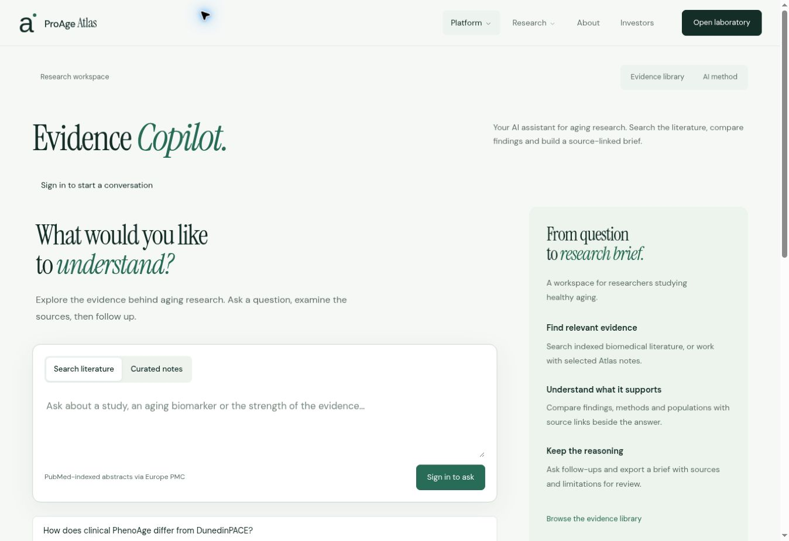

# AI evidence product — release verification, 25 October 2026

Production source: `5531b0652fe523d3ec0dc9056de88e049f159b74` (tree `8dd3a3119907d37a246a10891dc8566a86f2a24e`).

Cloudflare build `8fa4c17a-2da1-4426-9e8a-58793da69962` completed successfully. Deployment `db37497d-9e28-4f5e-bcec-3078fcbe795d` serves Worker version `f790aa22-a2b1-42a7-a1c8-feeae0f67cf4` at 100% traffic. Rollback reference: `backup/before-ai-evidence-product-20261025` → `5393a879718a5440d17197ce0c47fa6a70a0db0e`.

## Completed checks

- TypeScript checks, all 35 automated tests and the production build pass. New tests cover bounded conversations, scope-routing decisions with synthetic provider responses, malformed/failed classification, query injection, literature metadata normalization, retracted/preprint/invalid-source rejection, current-source citation validation, empty/outage behavior and streamed byte limits. Existing auth and calculator tests remain passing.
- Real Europe PMC retrieval: a DunedinPACE/CALERIE query returned 395 indexed matches and twelve records; the normalizer accepted six abstracts and constructed PubMed links. This verifies the actual retrieval service, not live Azure generation.
- Isolated Cloudflare review build for application commit `2455332f05c30901efbab6b33567a157f7599275` passed. Only README/deployment documentation changed between that application commit and production.
- Browser inspection of the assistant at 390, 768, 1440 and 1920 frame widths; additional overflow measurements at 360, 430, 599, 601, 959 and 961. All measured document scroll widths matched client widths. The native scrollbar consumes 15 pixels inside the frame, so effective content widths were frame width minus 15.
- Mobile home and tablet About inspected. Original green hero image and animation implementation remain unchanged; only hero text and destination links changed.
- Assistant examples populate the question. Both source modes work. Multiple curated sources can be selected without collapsing the picker; selected notes remain visible.
- JavaScript-disabled rendering retains product/method copy and the explicit fallback links to the evidence library and AI method. AI input is not usable without JavaScript.
- Production browser shows the new assistant, research-workspace navigation and the correct signed-out state. The sign-in CTA opens the existing Cloudflare Access email-code form. The research app remains verified-email access; no Access policy was widened or bypassed. Existing server-side secret names remain present.
- Temporary preview Worker and its build trigger were removed after production verification.

## Limits / owner acceptance still needed

No authenticated research session was available. A real Azure answer, live-model adversarial scope behavior, multi-turn answer fidelity and the browser download of an actual generated brief remain unverified. Automated provider fixtures are not evidence of model accuracy or prompt-injection resistance. The source/limit checks reduce risk but do not certify scientific correctness.

Direct shell HTTP smoke requests were rejected by Cloudflare screening with code 1010; this was not an application response. Browser rendering and the sign-in transition succeeded. Do not report a production anonymous API POST returning 401 from those blocked shell checks.

FPS, reduced-motion changes and all unrelated routes were not re-audited in this content/assistant change; the motion implementation was preserved. No patient data, credentials, enquiry records or model-generated clinical claims were used as test data.

